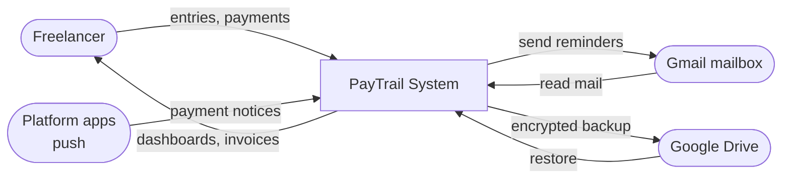

# PayTrail

> One honest ledger for Indian freelancers — track what you're actually owed across Upwork, Fiverr and direct clients.

**PayTrail** is an Android-first, **local-only** payment tracker built for Indian freelancers. Record clients, projects and milestones once; the app then pulls payment notices from Gmail and platform notifications, reconciles them into an exact ledger, surfaces what's overdue, drafts reminders, and exports tax-ready records — all while keeping every rupee encrypted on the device.

<p>
  
  
  
  
  
</p>

---

## Why it exists

Freelancers juggle income across platforms with no reliable, private way to see what they're truly owed:

- **Scattered income** — payouts land on Upwork, Fiverr, UPI and bank, reconciled by hand in fragile spreadsheets.
- **Gross ≠ take-home** — platform commission and TDS quietly eat the amount; true net earnings are easy to mis-count.
- **Dues slip late** — no systematic aging or follow-up, so overdue milestones are forgotten and cash flow stalls.
- **Privacy & tax stress** — financial history sits on third-party servers, and the year-end export is painful to assemble.

PayTrail answers all four without asking you to trust a server with your money history.

---

## Features

| Module | What it does |
| --- | --- |
| **1 · Core ledger** | Clients → projects → milestones → payments. Exact integer money, multi-currency totals, part payments, soft delete. |
| **2 · Dashboard & aging** | Total outstanding (per currency), overdue callout, aging buckets (not-yet-due / 0–30 / 31–60 / 61–90 / 90+), breakdown by source. |
| **3 · Ingestion** | Reads payment notices from **Gmail** (read-only) and **Android notifications**; parses and de-duplicates them into a review queue. |
| **4 · Reminders** | Surfaces overdue milestones, drafts polite follow-ups, and sends them from your **own connected Gmail**. |
| **5 · Export & backup** | Invoice **PDFs**, **CSV** tax export, and **end-to-end encrypted** backup to your own Google Drive. |

**Highlights:** 100% on-device storage · 256-bit SQLCipher encryption · 3 ingestion paths · 0 servers/accounts required · 145 automated tests.

---

## Screenshots

> Captured from the Android emulator. (Add images under `docs/screenshots/` and link them here.)

| Dashboard | Review Queue | Reminders | Backup & Sync |
| --- | --- | --- | --- |
| aging + outstanding | de-duplicated ingest | drafted follow-ups | E2E encrypted Drive |

---

## Architecture

Clean architecture — the dependency arrow points **inwards only**. `presentation` and `data` depend on `domain`; `domain` depends on nothing.

```
lib/
  domain/        Pure Dart. No Flutter, no Drift, no platform channels.
                 Money, MoneyBag, aging rules, reconciliation, reminder rules.
  data/          Drift schema + SQLCipher database, repository impls,
                 ingestion adapters, Gmail/Drive clients, PDF/CSV export.
  presentation/  15 screens, Riverpod providers, theme, widgets.
  core/          Display formatting.
```

Because the money arithmetic, aging rules and status logic live in pure Dart, they're testable without a widget tree or a database — `test/domain/` runs in milliseconds. The presentation layer only ever talks to repository **interfaces** declared in `domain/repositories/`; the UI has never heard of SQL.

### Data flow (Level 0 — context)



### Schema

```
payment_sources ──┬─< projects ──< milestones ──< payments
                  └─< milestones
clients ──< projects
```

Text UUID primary keys (not autoincrement): the same payment is ingested through three paths and exported rows may be re-imported, so ids must be stable without a round trip to the database. Indexes cover the real access paths (milestones by project and due date, payments by milestone and receipt date) plus a **partial unique index** on external transaction id.

---

## Tech stack

| Area | Technology |
| --- | --- |
| Framework / language | Flutter · Dart 3.12 (Material 3, light/dark) |
| State management | Riverpod 3 (declarative, testable providers) |
| Storage & security | Drift (SQLite ORM) · **SQLCipher** · key in **Android Keystore** via `flutter_secure_storage` |
| Integrations | Gmail API · Android notification listener · Google Drive (`drive.appdata`) |
| Output & sharing | `pdf` · `printing` · `syncfusion_flutter_pdf` · `csv` · `share_plus` · `file_picker` |
| Testing | `flutter_test` — 145 tests over domain, data and widgets |

---

## Getting started

### Prerequisites
- Flutter **3.12+** (Dart SDK ≥ 3.12.2)
- Android device or emulator, **API 23+** (required by the Keystore ciphers that hold the SQLCipher key)

### Run

```bash
flutter pub get
dart run build_runner build      # regenerate Drift code after schema changes
flutter test                     # 145 tests
flutter run                      # Android device or emulator
```

The core ledger, dashboard and export work offline with no setup. **Gmail ingest/send and Drive backup** additionally need Google OAuth (below).

### Google Cloud setup (for Gmail + Drive)

1. Create a project at [Google Cloud Console](https://console.cloud.google.com) and **enable** the *Gmail API* and *Google Drive API*.
2. **OAuth consent screen** → External → publishing status **Testing** → add your Google account as a **test user**.
3. Add scopes: `gmail.readonly`, `gmail.send`, `drive.appdata`.
4. Create two OAuth clients:
   - **Android** — package name = your `applicationId` (`android/app/build.gradle.kts`) + your signing **SHA-1**.
   - **Web** — copy its Client ID.
5. Paste the Web Client ID into `kGmailServerClientId` in `lib/presentation/providers/app_providers.dart`.

> The OAuth **client ID is public by design** (no client secret is used); it's safe to commit. App identity is enforced by package name + SHA-1 on Google's side.

---

## Design decisions worth defending

**Money is an integer, never a double.** `Money` holds minor units (paise, cents) plus a currency code. Binary floating point can't represent 0.10 exactly, so summing invoice lines as doubles drifts by fractions of a rupee. Commission and TDS are **basis points** (20% = 2000), applied with integer division rounding half away from zero.

**Cross-currency totals are a `MoneyBag`, not a number.** Upwork work in USD and direct clients in INR have no single "outstanding" figure without an exchange rate. Every aggregate returns a bag and the UI renders one line per currency — there's no way to read a bare amount without naming a currency, so the multi-currency case can't be forgotten.

**`overdue` and `paid` are derived, not stored.** The DB stores a `MilestoneStage` (pending / invoiced / cancelled). Overdue is a function of the due date and today. Status precedence is deliberate: cancelled > paid > overdue > part-paid — a client who paid half and is 60 days late is a collection problem, not a progress update.

**Outstanding is measured against net, not gross.** A ₹1,000 Fiverr order pays out ₹800. Measuring against gross would leave every completed order looking 20% unpaid forever. Commission and TDS both come off the gross — not off each other.

**Commission rates are snapshotted per milestone.** Each milestone stores the rate it was created with, so when Fiverr changes its cut, last year's completed work still reconciles against what was actually received.

**Payments are a table, not a column.** Part payments are the normal case. A running `paidAmount` would throw away the dates, references and provenance the tax export needs; `paidAt` is reconciled in one place after every write, so "paid" and "sum of payments" can't drift apart.

**The dedupe key is enforced by the database.** A partial unique index on `payments.external_txn_id` makes SQLite itself refuse a second row for the same platform transaction — so the same payout can arrive via notification, email **and** CSV without double-counting. NULL ids are exempt, which allows several manual part payments on one milestone.

**Encrypted from the first write.** `sqlite3` is built from SQLCipher (`hooks.user_defines.sqlite3.source: sqlcipher`). A 32-byte key is generated by the platform CSPRNG on first launch and stored in the **Android Keystore** via `flutter_secure_storage` — never in shared preferences, never in source. Startup asserts `PRAGMA cipher_version` is non-empty and fails loudly rather than falling back to plain SQLite.

> *Consequence, stated plainly:* the key lives and dies with the app install. Uninstalling or clearing app data destroys it and the ledger becomes unreadable. That's the right trade-off for a local-only ledger with no account behind it — and it's why the **E2E encrypted Drive backup** (encrypted with a passphrase only you hold) is the recovery story.

**Soft delete by default.** Clients and projects archive rather than delete; hard delete exists, is confirmed, and cascades. Deleting years of income history should take more than a stray tap.

---

## Tests

```bash
flutter test
```

| File | Covers |
| --- | --- |
| `test/domain/money_test.dart` | Parsing, exact arithmetic, basis-point rates, rounding |
| `test/domain/milestone_test.dart` | Net amount, outstanding, overdue, status precedence |
| `test/domain/aging_test.dart` | Aging buckets and boundaries |
| `test/domain/reconciliation_test.dart` | Ingest reconciliation and dedupe logic |
| `test/data/ledger_repository_test.dart` | Schema, reconciliation, dedupe, cascades, summaries |
| `test/data/payment_classifier_test.dart` | Classifying notifications/emails into payment events |
| `test/data/statement_parser_test.dart` | Parsing statement/notice text |
| `test/data/pdf_extraction_test.dart` | PDF attachment extraction |
| `test/data/backup_test.dart` | Encrypt → upload → download → decrypt round-trip |
| `test/presentation/client_list_test.dart` | Screens against a real in-memory database |

Widget tests run the **real repository over an in-memory database**, not a mock — the point is that the screens agree with the queries, and a hand-written fake would only prove the screens agree with the fake.

---

## Project context

Built as a **Mobile Application Development** mini-project. Single-codebase Flutter, clean architecture, 145 tests, privacy-first by design.

*PayTrail — freelancers keep their ledger; the ledger keeps the truth.*
